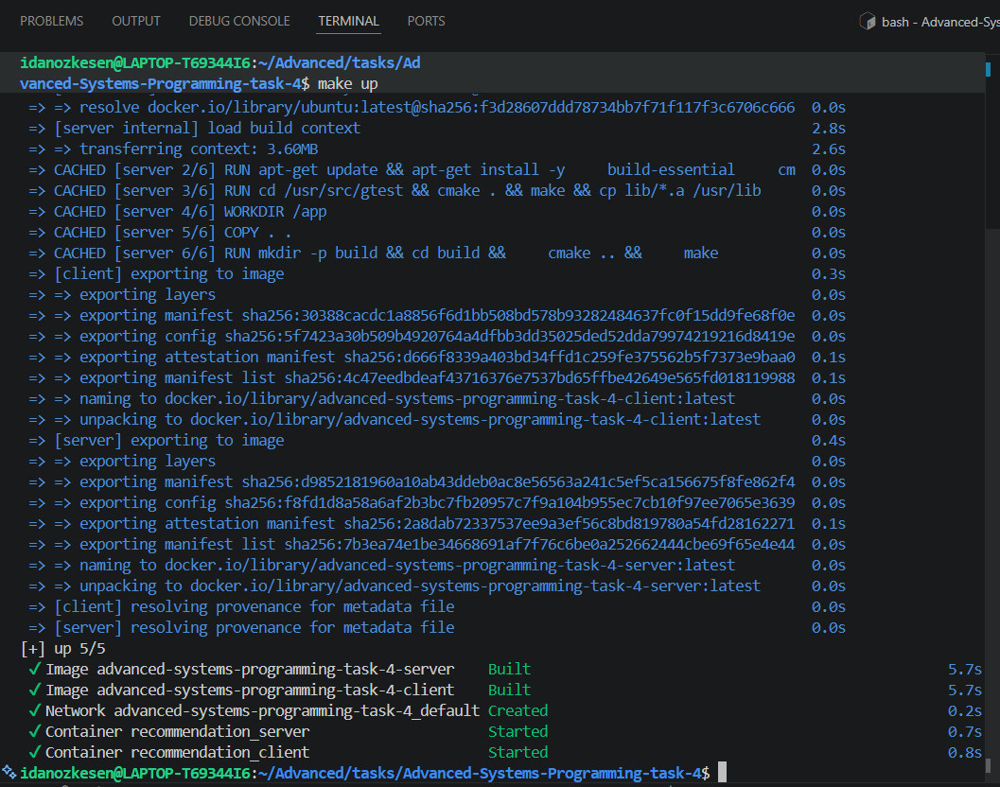
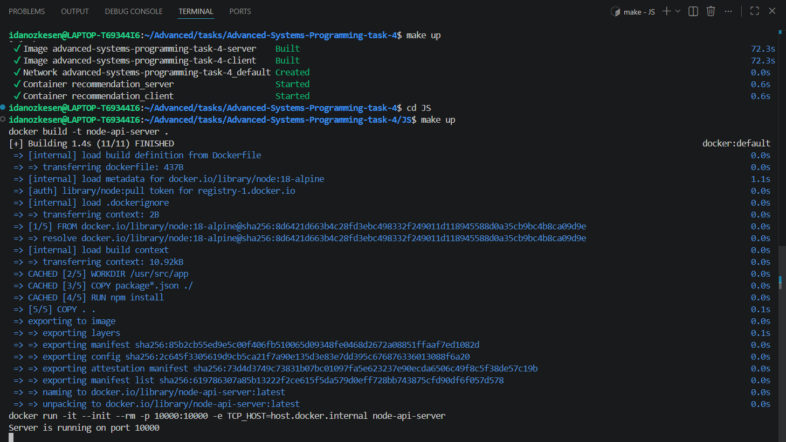
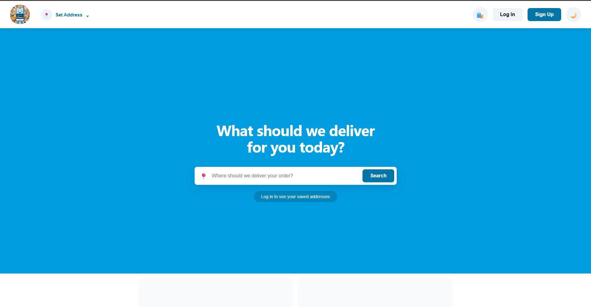
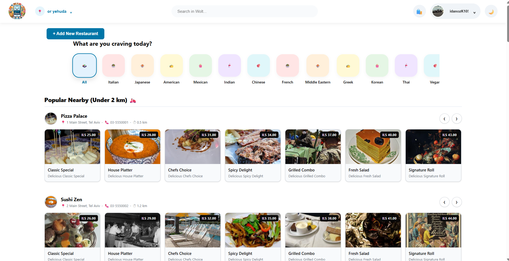
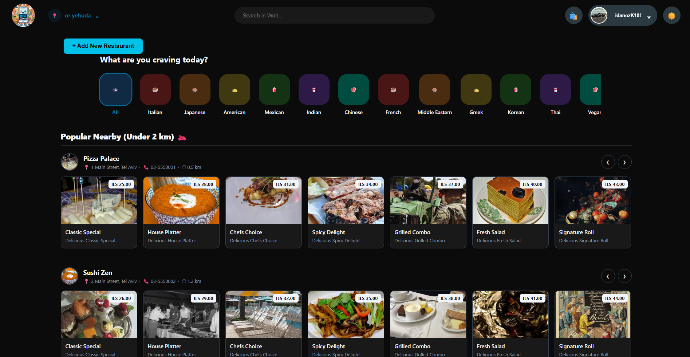
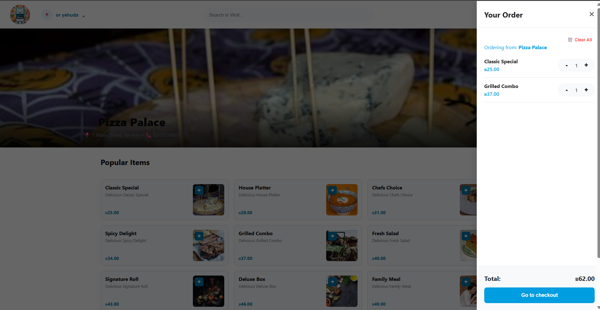
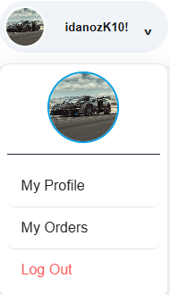

# Wolt Clone - Advanced Systems Programming (Ex4)

This project is a fully functional web application inspired by Wolt. It consists of a React frontend, a Node.js (Express) backend, and a C++ Recommendation Server.

## 🚀 How to Run the Project

The project uses Docker and Makefiles for an easy setup. Please follow these exact steps to compile and run all servers and applications.

### Prerequisites
* Docker & Docker Compose installed and running.
* Node.js and npm installed.
* `make` utility installed.

### Execution Steps

### **Step 1: Start the C++ Recommendation Server**
You must start this server first. Navigate to the C++ project directory and choose one of the following methods:

**Option 1: Running via Docker (Recommended)**:
We have provided a `Makefile` that handles building and running the containers automatically.

**1. Start the Server Environment:**
> This builds the Docker image, compiles the C++ code, and runs the server in the background on port 8080.
```bash
make up
```
*(This will build and run the C++ server and Python client containers in the background)*

> *NOTE:
> When you are done, you can shut down the container using:* 
```bash
make down 
```
**2. Run the GTest Suite:(Optional)**
>To run all unit and integration tests inside the container (all the cpp&h files):
```bash
make test
```

**Option 2: Using Make (Standard)**
**1. Execute these commands to compile**

> We will run the server on port 8080.
```bash
mkdir build
cd build
cmake ..
make
./run_server 8080
```

**2. Running tests(Optional)**
```bash
./run_tests
```

### **Step 2: Start the Node.js API (Using Docker)**
Make sure the C++ server is running first (via `make up` in the root directory).
Then, navigate into the `JS` directory where the Node.js API is located.

To build and run the Node.js server automatically, simply run:
```bash
cd JS
make up
```
*(Wait for the backend server to fully initialize)*

### **Step 3: Start the React Frontend**
Open a **new terminal window**, navigate to the React application folder, and start the development server:
```bash
cd ..
cd wolt-web
npm start
```
*(The React application will automatically open in your default browser at http://localhost:3000)*

### 📸 Screenshots
*(Instructor Note: Below are the screenshots demonstrating the successful compilation, running of the servers, and the application interface)*

**Terminal successfully running docker-compose:**



**React Application Interface:**


---

### **Step 4: Initialize the Database (Seeding) - *Optional but Recommended***
To help you easily populate the database with initial data, we have provided a custom `seed.sh` script. Simply open a terminal in the Wolt Web directory and execute it:

```bash
bash seed.sh
```
(Note: This script automatically generates multiple default restaurants, complete with menus and random placeholder images we provided. Running this is completely optional—the site functions normally without it—but it is highly recommended as it gives the application a realistic, vibrant look right out of the box. Please keep in mind: because these default restaurants are created by the system, standard users cannot edit or delete them, as they are not the owners. However, you can freely browse their menus and place orders!)

## 🛠️ Workflow & Development Process

Our team followed a strict Agile development process, documenting our workflow as required.

* **Jira & Sprints:** We managed our tasks using Jira, dividing the work into Epics, User Stories, and Tasks. We appointed a Scrum Master, planned our sprints, and held status meetings at least twice a week. All activities, conclusions, and task status updates (e.g., in progress, code review, done) were meticulously logged.
* **Git & Feature Branches:** We worked exclusively with feature branches, maintaining a clean main branch.
* **Code Reviews:** All code integration was handled strictly via Pull Requests (PRs). Every PR required a thorough code review and explicitly needed approval from a different team member before being merged.
* **Traceability:** We mapped all tasks to feature branches, matching the Jira issue names to the branch names to ensure smooth integration between GitHub and Jira.

---

## 🔐 Security Notice
In compliance with project guidelines, no real passwords, private information, sensitive data, tokens, or API keys are uploaded to GitHub or stored anywhere in the codebase, database, or Docker files. 

---

## 📱 Application Features & Usage Guide

### Guest Access
You can easily explore the application as a guest! Simply enter your delivery address on the main screen to browse nearby restaurants, view menus, and search for items without needing an account.




* **Dark Mode / Light Mode:** Easily toggle between viewing themes using the dedicated switch in the top navigation bar to suit your personal preference.



**Strict Registration Validations:**
* **Password:** Must be at least 8 characters long, and include at least one uppercase letter, one number, and one special character.
* **Phone Number:** Must contain valid numeric digits only and 7-10 digits.

### Registered Users & Authentication
To unlock the full capabilities of the application, such as **placing an order** or **creating a new restaurant**, you must sign up and log in.

### Restaurant Ownership & Management
* **Create & Edit:** As an authenticated user, you can create your very own restaurant and populate it with a custom menu of products. You retain full control to update and edit your restaurant's details and menu items at any time.
* **Access Control:** Restaurant modifications are strictly restricted to the creator (owner). If you visit a restaurant created by someone else, you can seamlessly browse the menu and place orders, but you will not have permission to alter any of its data.


### Cart & Ordering Rules
* **Single Restaurant Policy:** Just like the real Wolt app, a single order can only contain items from one restaurant at a time. Mixing items from multiple restaurants in the same cart is not allowed.


### User Dashboard
Once authenticated, users unlock a personalized experience:
* **My Profile:** View and edit your saved personal details, profile picture, and current delivery address.
* **Order History:** Access a dedicated page to view all your past orders and receipts.


